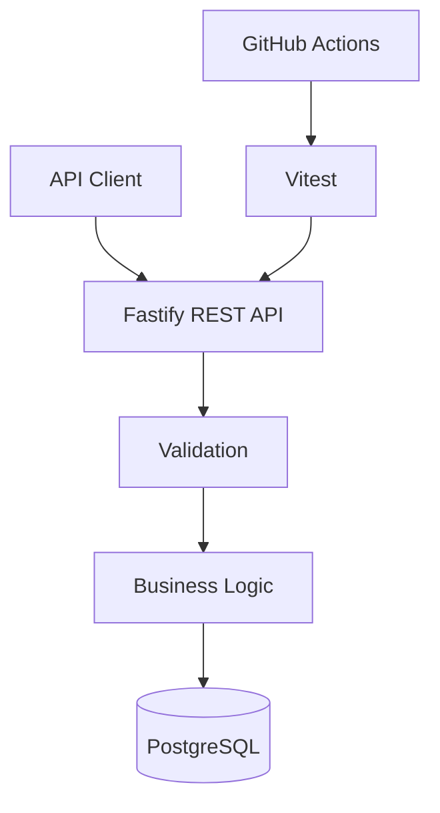
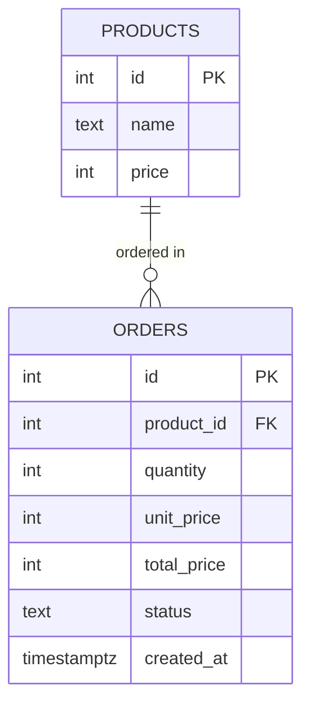

# MiniOrder API

[](https://github.com/310kai/miniorder-api/actions/workflows/ci.yml)

架空のカフェ向けモバイルオーダーシステムのバックエンドAPIです。

## 1. プロジェクト概要

MiniOrderは、お客様が商品を注文し、店舗スタッフが注文の受付・準備・提供状況を管理することを想定したシステムです。

注文待ち時間の削減、店舗業務の効率化、顧客体験の向上を目指しています。

個人開発を通じて、REST API開発、データベース設計、自動テスト、CIの構築を実践的に学習することを目的としています。

## 2. 実装済み機能

- 商品一覧取得
- 商品詳細取得
- 注文作成
- 注文情報取得
- 注文ステータス更新
- 不正な入力・状態遷移の検証
- PostgreSQLへのデータ永続化
- 自動テスト・CI

## 3. 技術スタック

| 分類 | 使用技術 |
|---|---|
| 言語 | TypeScript |
| 実行環境 | Node.js 24 |
| API | Fastify |
| データベース | PostgreSQL 17 |
| コンテナ | Docker Compose |
| テスト | Vitest |
| CI | GitHub Actions |
| バージョン管理 | Git / GitHub |

## 4. システム構成



## 5. データベース設計



現在は1注文につき1商品を扱うシンプルな構成です。

## 6. API一覧

| Method | Endpoint | 説明 |
|---|---|---|
| GET | /health | サーバー状態確認 |
| GET | /products | 商品一覧取得 |
| GET | /products/:id | 商品詳細取得 |
| POST | /orders | 注文作成 |
| GET | /orders/:id | 注文情報取得 |
| PATCH | /orders/:id/status | 注文状態更新 |

詳細は [API仕様書](docs/api.md) を参照してください。

## 7. セットアップ

### 必要な環境

- Node.js 24
- npm
- Docker Desktop

### 依存パッケージのインストール

```bash
npm ci
```

### 環境変数の設定

```bash
cp .env.example .env
```

`.env` の `DB_PASSWORD` を安全なパスワードに変更してください。

### PostgreSQLの起動

```bash
docker compose up -d --wait
```

### データベース初期化

```bash
docker compose exec -T db psql -v ON_ERROR_STOP=1 -U miniorder -d miniorder < db/schema.sql
```

### APIサーバー起動

```bash
npm run dev
```

以下にアクセスして確認します。

http://localhost:3000/health

## 8. テスト

### 型チェック

```bash
npx tsc --noEmit
```

### 基本自動テスト

```bash
npm test
```

### PostgreSQL統合テスト

テスト用の環境変数を設定します。

```bash
cp .env.test.example .env.test
```

`.env.test` のパスワードを変更後、テスト用DBを起動します。

```bash
docker compose -p miniorder-testing --env-file .env.test -f compose.test.yaml up -d --wait
```

統合テストを実行します。

```bash
npm run test:integration
```

開発用DBとテスト用DBは分離されています。

## 9. CI

GitHub Actionsを使用し、mainへのPushおよびPull Request時に以下を検証します。

- TypeScript型チェック
- 基本自動テスト
- PostgreSQL統合テスト

## 10. 現在の制約・今後の開発

現時点ではバックエンドAPIのみ実装しています。

今後は以下を予定しています。

- 認証・認可
- AWSへのデプロイ
- お客様用注文画面
- 店舗スタッフ用管理画面
- 複数商品を含む注文
- 在庫管理
- ログ・監視

実際の決済機能は未実装です。

## 11. 開発目的

バックエンドエンジニアへの転職を目指し、個人開発を通じて、設計・実装・テスト・改善を継続的に学習しています。
