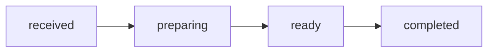

# MiniOrder API仕様書

## 基本情報

Base URL: http://localhost:3000

Content-Type: application/json

## GET /health

サーバーの稼働状況を取得します。

レスポンス：200 OK

```json
{
  "status": "ok"
}
```

## GET /products

商品一覧を取得します。

レスポンス：200 OK

```json
[
  {
    "id": 1,
    "name": "コーヒー",
    "price": 350
  }
]
```

## GET /products/:id

商品IDを指定して商品情報を取得します。

例：GET /products/1

- 200：取得成功
- 400：商品IDが不正
- 404：商品が存在しない

## POST /orders

新しい注文を作成します。

リクエスト：

```json
{
  "productId": 1,
  "quantity": 2
}
```

レスポンス：201 Created

```json
{
  "id": 1,
  "productId": 1,
  "quantity": 2,
  "unitPrice": 350,
  "totalPrice": 700,
  "status": "received"
}
```

入力制約：

- productId：1以上の整数、最大2147483647
- quantity：1〜99の整数
- 存在しない商品は注文不可

## GET /orders/:id

注文IDを指定して注文情報を取得します。

例：GET /orders/1

- 200：取得成功
- 400：注文IDが不正
- 404：注文が存在しない

## PATCH /orders/:id/status

注文のステータスを変更します。

リクエスト：

```json
{
  "status": "preparing"
}
```

レスポンス：200 OK

注文状態の遷移：



状態の意味：

- received：受付済み
- preparing：準備中
- ready：受け取り可能
- completed：受け取り完了

許可されない状態遷移は409 Conflictを返します。

## HTTPステータス

| Status | 意味 |
|---|---|
| 200 | 取得・更新成功 |
| 201 | 注文作成成功 |
| 400 | 入力値が不正 |
| 404 | 対象データなし |
| 409 | 不正な状態遷移 |
| 500 | サーバー内部エラー |

## 注意事項

- 認証・認可は未実装です
- 決済処理は未実装です
- 1注文につき1商品の構成です
- 開発用APIとしてローカル環境で動作します
